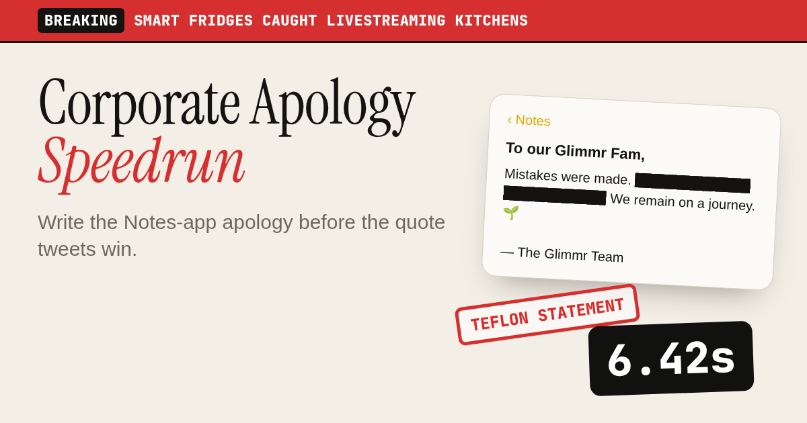

# Corporate Apology Speedrun 🙇

Something terrible has happened. Write the Notes-app apology before the quote tweets win.

**Play: https://apology-speedrun.pages.dev**

A tiny browser game: you run comms for a (fictional) company mid-scandal. Assemble the corporate apology in five picks as fast as you can, survive a plot twist, and get a shareable screenshot of your statement, time, grade and top reply.



## How it plays

- **Five picks:** opener → acknowledge (sort of) → explain (blame someone) → promise action (vaguely) → close it out. Keys `1`–`4` or tap.
- **Legal traps:** one line per step won't survive review. Picking it costs **+2.5s**, and it shows up **redacted** in the final statement.
- **Plot twists:** every run gets one:
  - 📞 **The CEO grabs the phone.** Let him post his P.S., or mash to talk him down while the clock runs.
  - 📰 **The story escalates.** An `UPDATE:` lands on the headline and you have to address it.
  - ⚖️ **Legal enters the room.** Two lines on the next step get flagged.
- **Live replies** react to what you pick. The best one is the **Top reply** on your result image.
- **Daily Scandal #N:** everyone gets the same scandal, lines and twist each day, so you can compare times.
- Personal bests, per-step splits compared against your PB, and sound you can mute.

## Run locally

It's static HTML/CSS/JS with no build step:

```sh
python3 -m http.server 8000
# open http://localhost:8000
```

Debug: in Random mode, `?twist=ceo`, `?twist=escalate` or `?twist=legal` forces a twist.

## Project layout

| File | What's in it |
| --- | --- |
| `index.html` | Page shell and screens |
| `styles.css` | All styling |
| `game.js` | Game loop, twists, replies, scoring, share-image renderer (canvas) |
| `data.js` | Scandals, apology lines, traps, twists, replies. **Add content here.** |
| `og.png` | Social preview image |

## Contributing

PRs adding scandals, lines and replies are the most welcome kind. Keep every company, person and handle **fictional**: no real brands or real people. Each line in `data.js` has `s` (sincerity), `d` (deflection) and `c` (cringe) scores that feed the verdict.

## License

[MIT](LICENSE)
